<!-- Custom Visual Hero Banner -->

 

### ⚡ AI Builder • Product Experimenter

**Turning ideas into working products through AI-assisted development.**

---

<table width="100%">
<tr>
<td width="60%" valign="top">

### 👨‍💻 About Me

I'm a 3rd-year **B.Tech CSE (AI & ML)** student at **Malla Reddy Engineering College**, Hyderabad.

I identify as an **AI Builder and Product Experimenter**. I use AI coding assistants (OpenCode, GitHub Copilot, Cursor) as a core part of my development process to turn ideas into working applications quickly.

**My workflow:** Imagine → Build → Test → Modify → Improve

I can understand the overall flow of generated code, make modifications, experiment with different implementations, and improve projects iteratively. My strength lies in idea generation, rapid prototyping, and experimentation.

I am continuously improving my software engineering fundamentals — system design, testing strategies, debugging, and deployment — through hands-on project work.

**Outside tech:** Motorsport, gaming, and exploring open-source developer tooling.

</td>
<td width="40%" valign="top">

### 📌 Quick Overview

- 🎓 **Degree**: B.Tech CSE (AI & ML)
- 🏫 **College**: Malla Reddy Eng. College
- 🗓️ **Expected Graduation**: 2028
- 📍 **Location**: Hyderabad, India
- 🎯 **Focus**: AI-powered applications, rapid prototyping, product experimentation
- 🤖 **Workflow**: AI-assisted development (OpenCode, Copilot, Cursor)

</td>
</tr>
</table>

---

### 🎯 What I Build (AI-Assisted Prototypes & Experiments)

<table width="100%">
<tr>
<td width="50%" valign="top">

#### 🤖 Generative AI & LLM Pipelines
Multi-stage generation with typed schemas, repair loops, and provider fallback cascades. Built via AI-assisted TypeScript/Next.js.

</td>
<td width="50%" valign="top">

#### 🧠 AI Agents & Multi-Agent Systems
Orchestration platforms with shared state, tool isolation, and human-in-the-loop controls. Built via AI-assisted Python.

</td>
</tr>
<tr>
<td width="50%" valign="top">

#### 📊 Applied Machine Learning (Learning)
Classical ML with honest evaluation splits (client-holdout, subject-split). Building fundamentals through scikit-learn projects.

</td>
<td width="50%" valign="top">

#### ⚙️ Backend Engineering (Learning)
FastAPI microservices, Pydantic validation, audit logging. Building intuition through AI-assisted projects.

</td>
</tr>
</table>

---

### 🛠️ Technology Experience

#### 1. Programming & Fundamentals (Daily Use / Basic Proficiency)

*Python for daily coding, Git for version control, Linux as daily driver, basic SQL queries.*

---

#### 2. Application Development (Project Experience via AI Assistance)

*Technologies used in projects with substantial AI coding assistance. I understand the purpose and can navigate/modify the code, but am still building independent proficiency.*

| Category | Technologies |
|---|---|
| **Languages** |  |
| **Backend & Frameworks** |    |
| **Validation & Schemas** |   |
| **Data & ORM** |    |
| **AI/ML Integration** |    |
| **Styling & UI** |    |

---

#### 3. AI Development Toolkit (Daily Workflow)

---

#### 4. Areas of Interest (Actively Exploring)

*Learning testing, containerization, CI/CD, numerical computing, and notebook workflows through project work.*

---

### 🚀 Featured Projects (AI-Assisted Experiments)

<table width="100%">
<tr>
<td width="100%">

### 🧾 1. [Receivables-AI](https://github.com/amoghreddy07/Receivables-AI)
**B2B Revenue Recovery Agent — AI-Assisted Experiment**

- **Context**: Built as a Razorpay AI Buildathon 2026 submission. Explores deterministic policy control around an LLM for financial actions.
- **Built with**: Heavy AI assistance for FastAPI, SQLAlchemy, Pydantic, policy engine, hash-chained audit logging, and evaluation harness.
- **What I learned**: REST API design, ORM patterns, validation boundaries, audit trails, benchmark evaluation methodology.
- **Verified**: 62 passing tests (AI-assisted). Offline 63-case benchmark shows **97.4% recovery rate** vs 51.3% naive baseline (13 compliance violations in baseline).
- **Stack**: `Python` • `FastAPI` • `SQLAlchemy` • `Pydantic` • `Jinja2` • `SQLite`

</td>
</tr>
<tr>
<td width="100%">

### 🛰️ 2. [OneAtlas Pipeline](https://github.com/amoghreddy07/oneatlas-pipeline) • [*Live Demo*](https://oneatlas-pipeline-navy.vercel.app)
**Multi-Stage LLM App Specification Generator — AI-Assisted Experiment**

- **Context**: Explores breaking down app generation into validated stages with repair loops and provider cascades.
- **Built with**: Heavy AI assistance for Next.js 16, TypeScript, Zod validation, 3-stage pipeline (Intent → Schema → AppSpec), repair engine, SSE streaming, Vercel deployment.
- **What I learned**: React/Next.js patterns, TypeScript type system, Zod schema validation, LLM provider integration, serverless deployment.
- **Limitation**: Committed evaluation artifacts show **0/12 successful runs** (run without configured API keys). Honest evaluation requires valid provider credentials.
- **Stack**: `TypeScript` • `Next.js 16` • `React 19` • `Zod` • `Tailwind CSS` • `Groq/Gemini APIs`

</td>
</tr>
<tr>
<td width="100%">

### 🧠 3. [ExecuMind-AI](https://github.com/amoghreddy07/ExecuMind-AI)
**Simulated Executive Boardroom — AI-Assisted Experiment**

- **Context**: Explores multi-agent orchestration for business analysis via an 8-agent pipeline (Finance, Market, Customer, Operations, Risk, Strategy, Debate, Report) sharing a unified `WorkflowState`.
- **Built with**: Heavy AI assistance for Streamlit, agent orchestration, Gemini API integration, shared state management.
- **What I learned**: Multi-agent patterns, state management, Streamlit UI, LLM prompt engineering, test-driven development for state layers.
- **Verified**: 87 passing tests (AI-assisted) for `WorkflowState` and `MemoryManager` layers.
- **Note**: The deterministic analytics tools in `tools/` (~2,700 lines) are implemented but **not wired into the agent pipeline**.
- **Stack**: `Python` • `Streamlit` • `Google Gemini API` • `pandas` • `pytest`

</td>
</tr>
</table>

---

### 📈 GitHub Activity

<table border="0">
<tr>
<td width="50%" align="center">

</td>
<td width="50%" align="center">

</td>
</tr>
</table>

---

### 🔬 Currently Exploring

- 📚 **RAG & Vector Retrieval Evaluation**: Learning evaluation frameworks for retrieval pipelines.
- ⚡ **Agent State Machine Reliability**: Studying deterministic state graphs for autonomous workflows.
- 📊 **Honest Model Benchmarking**: Practicing client-holdout and subject-split evaluation to avoid data leakage.
- 🏗️ **Software Engineering Fundamentals**: System design, testing strategies, debugging, CI/CD, deployment.

---

### 📬 Connect With Me

  
  
  

 

Hyderabad, India • B.Tech CSE (AI & ML), 2024–2028 • AI Builder • Product Experimenter

